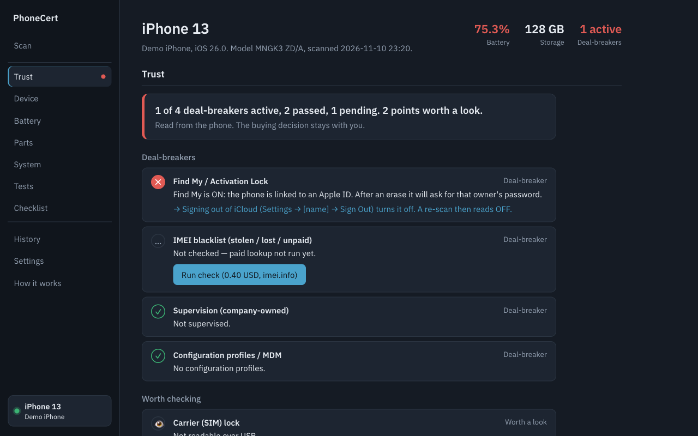
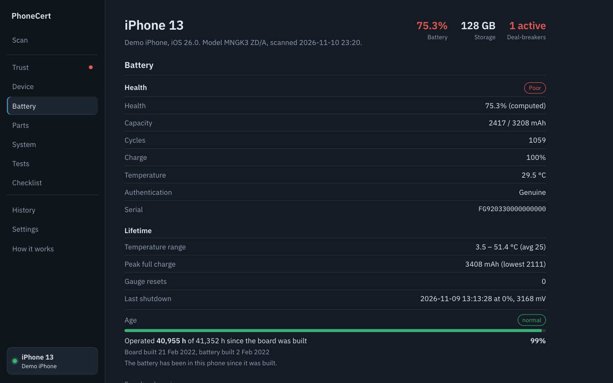
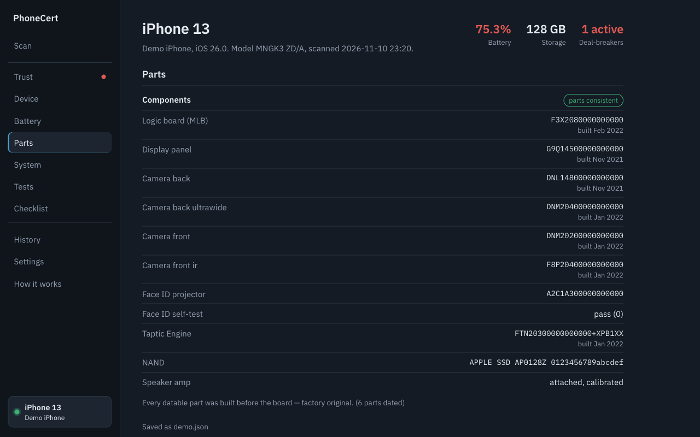
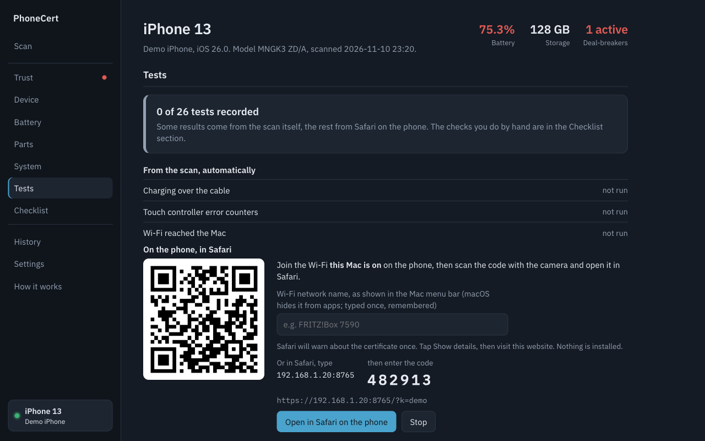
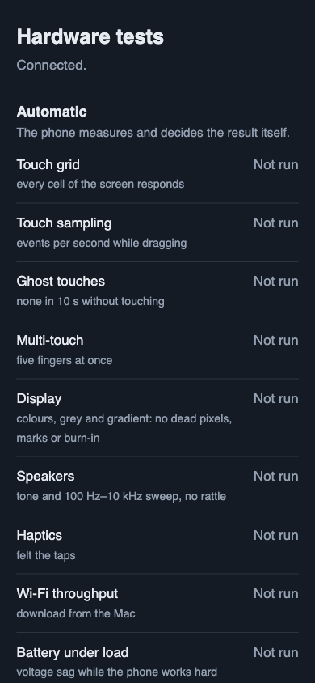

# PhoneCert

Desktop diagnostic tool for used iPhones: battery health, parts originality,
authenticity, lock status and functional tests, with a PDF certificate for buyers.

- Connection: USB + "Trust This Computer" (nothing installed on the iPhone)
- Core: Python + pymobiledevice3
- See PLAN.md for milestones

## Screenshots

The Trust section lists the buyer deal-breakers first (demo data, made-up serials):



| Battery | Parts |
| --- | --- |
|  |  |

### Hardware tests on the phone

The Tests section shows a QR code; the phone opens the test page in Safari over Wi-Fi and
sends each result back to the Mac. Nothing is installed on the phone.



| Test list in Safari | Touch grid in progress |
| --- | --- |
|  |  |

## Run

```bash
./setup.sh                      # once: Python venv + pymobiledevice3
source .venv/bin/activate
phonecert scan                  # CLI scan, saves reports/<serial>_<date>.json
phonecert devices               # connected iPhones
phonecert reports               # saved scans

# Desktop app (Tauri 2 + React). Needs Node 20+, pnpm and Rust (https://rustup.rs)
cd desktop && pnpm install && pnpm tauri dev
```

## What it does not do

PhoneCert only reads what a trusted, unlocked iPhone reports over USB. It does not
bypass Activation Lock, remove a carrier lock, unlock a passcode or change anything
on the phone.

Several verdicts rest on thresholds that are still provisional (battery internal
resistance, kernel-panic risk, part build dates), measured on two test phones so far.
Treat a report as a help for your own judgement, not as proof.

## Your data

Scan reports in `reports/` contain the phone's serial number, IMEI and SIM
identifiers. The folder is gitignored; do not attach a raw report to a public issue.
The sample report and test fixtures in this repository use made-up identifiers.

## Licence

GPL-3.0-only, see [LICENSE](LICENSE). PhoneCert builds on
[pymobiledevice3](https://github.com/doronz88/pymobiledevice3), which is GPL-3.0.

Not affiliated with or endorsed by Apple. iPhone is a trademark of Apple Inc.
